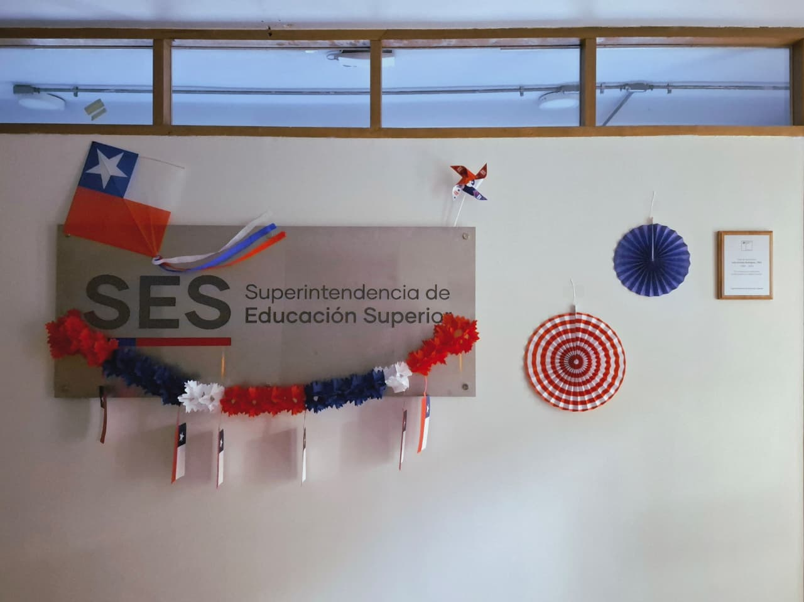
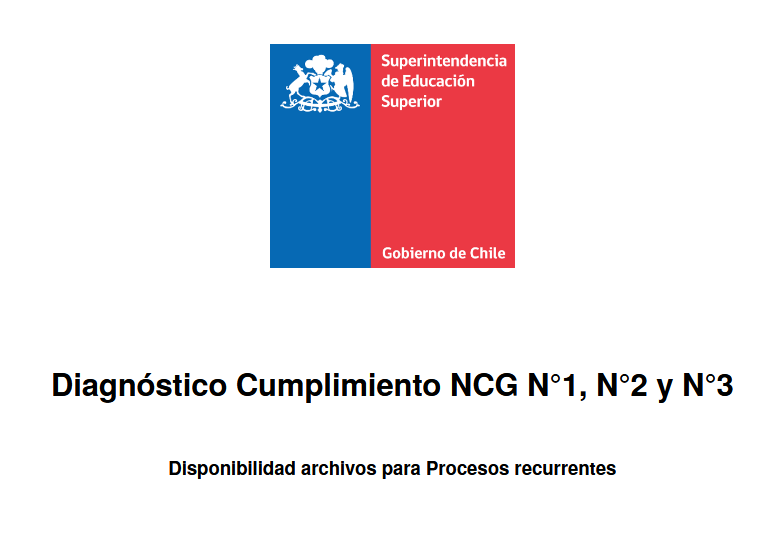
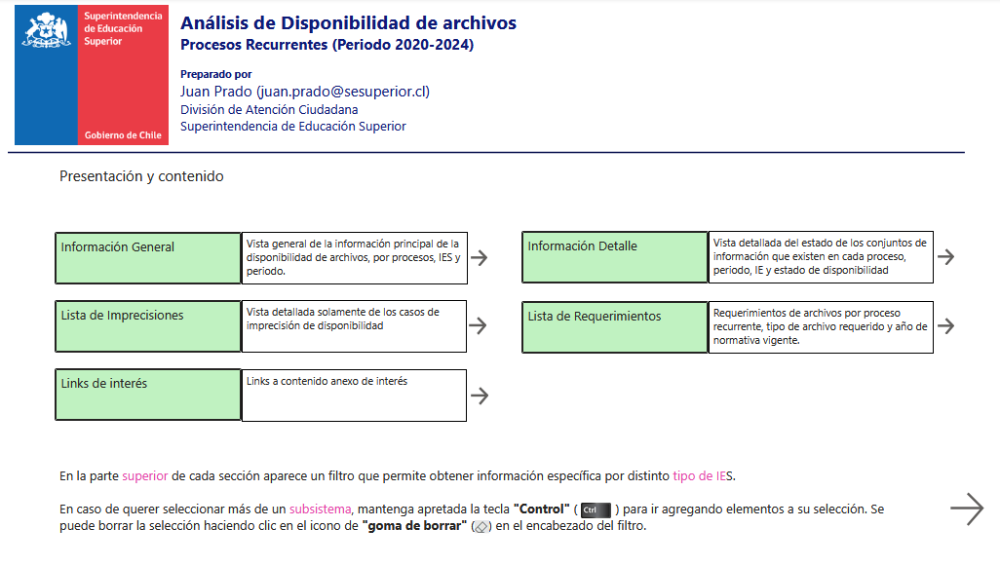
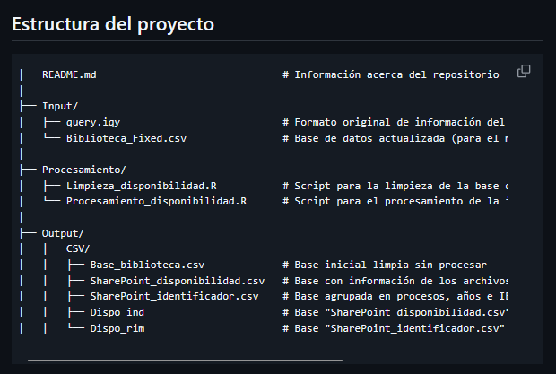
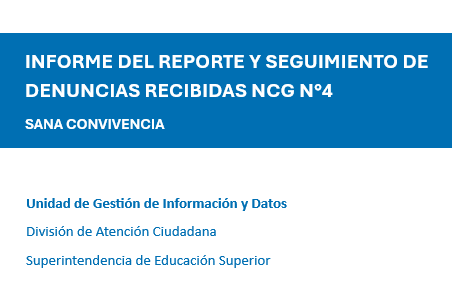
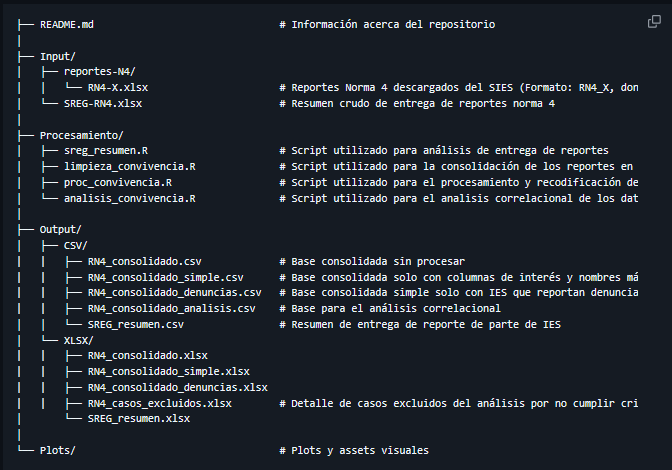
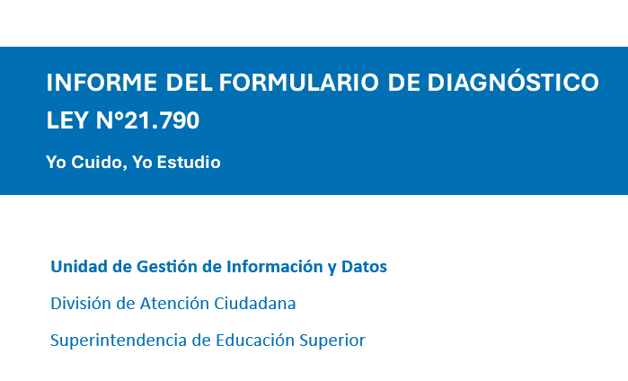
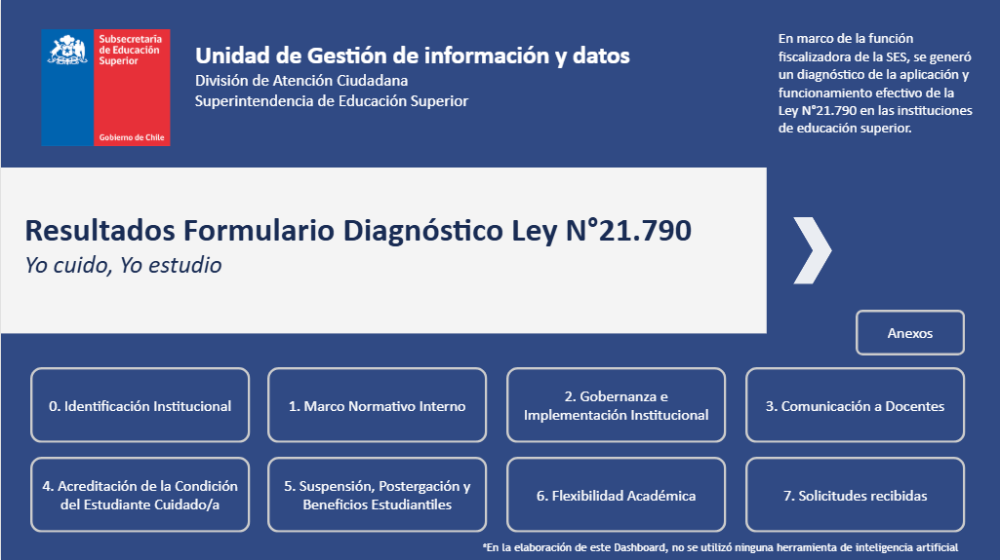
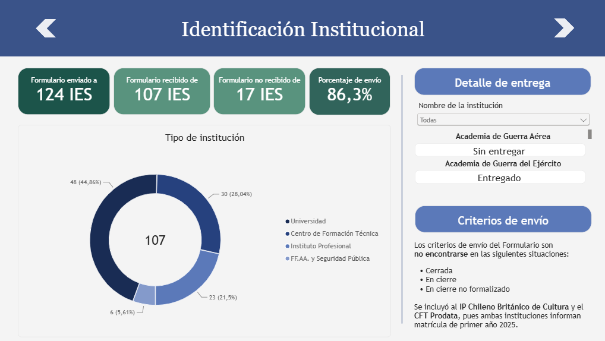

<style>

:root {
  --navy: #530909;
  --teal: #963700;
  --muted: #5b5e7a;
  --light: #F7F8FA;
  --line: #D9DEE7;
  --soft: #EEF7F6;
}

.reveal {
  font-family: Arial, Helvetica, sans-serif;
  color: var(--navy);
  font-size: 30px;
}

.reveal .slides { text-align: left; }
.reveal section { padding: 0.6rem 0.8rem; }
.reveal h1 {
  font-size: 1.55em;
  color: var(--navy);
  line-height: 1.08;
  font-weight: 650;
  letter-spacing: -0.018em;
  margin-bottom: 0.55rem;
}
.reveal h2, .reveal h3 { color: var(--navy); font-weight: 650; }
.reveal p, .reveal li { font-size: 0.70em; line-height: 1.35; }
.reveal strong { font-weight: 700; }
.reveal pre { margin: 0.45rem 0; box-shadow: none; width: 100%; }
.reveal pre code {
  font-size: 0.72em;
  line-height: 1.25;
  max-height: none;
  border-radius: 8px;
  background: #F2F4F7;
  color: #530909;
  padding: 0.55rem 0.65rem;
}
.reveal code { color: #530909; background: #F2F4F7; border-radius: 4px; padding: 0 .15em; }
.reveal table {
  font-size: 0.64em;
  width: 100%;
  border-collapse: collapse;
  margin-top: 0.35rem;
}
.reveal th {
  color: var(--navy);
  font-weight: 700;
  border-bottom: 2px solid var(--line);
}
.reveal td {
  border-bottom: 1px solid #EEF0F3;
  padding: 0.34rem 0.4rem;
}
.reveal .live {
  color: var(--teal);
  font-weight: 700;
  font-size: .54em;
  letter-spacing: .05em;
  text-transform: uppercase;
  margin-bottom: .22rem;
}
.reveal .idea { font-size:.78em; font-weight:700; color:var(--navy); }
.reveal .muted { color:var(--muted); font-size:.62em; }
.reveal .big { font-size:1.12em; font-weight:700; }
.reveal .centered { text-align:center; }
.reveal .flow { font-size:0.90em; line-height:1.42; font-weight:700; text-align:center; }
.reveal .small { font-size:.54em; }
.reveal .result { font-size:1.00em; font-weight:700; color:var(--navy); }
.reveal .warn { color:#9f358b; font-weight:700; }
.reveal .ok { color:var(--teal); font-weight:700; }
.reveal blockquote { border-left: 4px solid var(--teal); padding-left: 0.75rem; color:var(--navy); }
.reveal .twocol { display:grid; grid-template-columns: 1fr 1fr; gap: 1.15rem; align-items:start; }
.reveal .twocol-visual { display:grid; grid-template-columns: 1.12fr .88fr; gap: 1.15rem; align-items:center; }
.reveal .boxline { border-left: 4px solid var(--teal); padding-left:.6rem; }
.reveal .thin { font-weight:400; }
.reveal .footnote { color:#667085; font-size:.44em; line-height:1.25; }
.reveal .math-display { margin: .25rem 0 .55rem; }
.reveal .eq-flow { display:flex; align-items:center; justify-content:center; gap:.65rem; margin:.25rem 0; }
.reveal .eq-step { text-align:center; min-width: 26%; }
.reveal .eq-step .label { color:var(--muted); font-size:.50em; font-weight:700; letter-spacing:.05em; text-transform:uppercase; }
.reveal .eq-arrow { color:var(--teal); font-weight:700; font-size:1.1em; }
.reveal .photo-frame { margin:0; }
.reveal .photo-frame img {
  width:100%;
  max-height: 430px;
  object-fit: cover;
  border-radius: 12px;
  box-shadow: 0 12px 30px rgba(23,35,58,.10);
}
.reveal .photo-frame.contain img { object-fit: contain; background:#F2F4F7; }
.reveal .caption { color:#667085; font-size:.38em; line-height:1.2; margin-top:.32rem; }
.reveal .hero-title { font-size:1.65em; line-height:1.05; margin-bottom:.35rem; }
.reveal .kicker { color:var(--teal); font-size:.48em; font-weight:700; letter-spacing:.08em; text-transform:uppercase; margin-bottom:.15rem; }
.reveal .subtle-band { border-top:1px solid var(--line); padding-top:.35rem; margin-top:.45rem; color:var(--muted); font-size:.56em; }
.reveal .slide-number { color:#9AA3B2 !important; }
.reveal .progress span { background: var(--teal) !important; }

</style>


# 
<div class="twocol-visual">
<div>

<div class="kicker">División de Atención Ciudadana</div>

<div class="hero-title"><strong>Reporte Final Práctica Profesional</strong></div>

<div class="flow" style="text-align:left;">Juan Prado</div>

</div>
<div>

<figure class="photo-frame">

<figcaption class="caption">Superintendencia de Educación Superior</figcaption>
</figure>

</div>
</div>


# 

::: {.fragment}
**Nota:** Para ver más detalles, navegar verticalmente
:::


# 1. Diagnóstico Disponibilidad Procesos Recurrentes

<div class="kicker">Solicitud interna</div>

> Con el objetivo de tener un mejor conocimiento de la información que la División posee, se solicitó realizar un diagnóstico en el repositorio **Datos, Información e Estudios** ("*Cerebro*")

Se revisaron los siguiente **procesos recurrentes**:

::: {.fragment}
```text
Estados Financieros (intermedios y anuales)
Fondo Solidario Crédito Universitario
Gratuidad
Operaciones de Personas Relacionadas
Donaciones
```
:::

::: {.fragment}
**Conclusión (breve)**: Destaca una disponibilidad alta en OPR, Donaciones y FSCU, pero persisten brechas en Estados Financieros y Gratuidad. Se recomienda estandarizar nombres, mejorar repositorios y repetir diagnósticos periódicamente. 
:::


# Productos Relacionados


::: {.fragment}
**Informe Completo**

Se realizó un informe que expone los principales resultados del proceso y del estado de disponibilidad

```P1
https://juan-jap.github.io/Reporte_Disponibilidad_SES/
```
::: 


::: {.fragment}
**Dashboard** (PowerBI)

Se ofrece una mejor visualización y búsqueda específica acerca de cada IES, proceso y fecha 

```P2
https://superinteducacion.sharepoint.com/:u:/s/DivisindeGestindeDatosyBuenasPrcticas/IQBX6m8r8UbqTYq3H3NkcbKdARAv7UueIWCRQx_zxQiCDYI?e=M78rNz
```
::: 

::: {.fragment}
**Repositorio de Procesamiento Datos** 

Con el fin de transparencia y reproductibilidad se comparte el repositorio de procesamiento que tuvo el proyecto. Formato Git

```P2
https://github.com/Juan-JAP/disponibilidad_proc_recurr_ses
```
::: 


## 1.1. Informe Diagnóstico

<div class="twocol-visual">
<div>

Se realizó un informe en formato html con los siguientes apartados:

::: {.fragment}
**Resumen**: Portada del informe, breve resumen del producto

**1. Introducción**: Descripción del contexto institucional del diagnóstico

**2. Antecedentes**: Información acerca del repositorio a analizar, los procesos recurrentes y los criterios de evaluación.

**3. Metodología**: Explicación de metodología y Bases de datos creadas

**4. Resultados**: Exposición de principales resultados

**5. Conclusiones**: Resolución del proceso, límites y recomendaciones

**Apéndice 1**: Detalle de la información disponible en el SRI

**Apéndice 2**: Explicación del Dashboard como herramienta de fiscalización

::: 

</div>
<div>

::: {.fragment}

<figure class="photo-frame">

<figcaption class="caption">Versión descargable PDF</figcaption>
</figure>

::: 

</div>
</div>


## 1.2. Dashboard Diagnóstico


<div class="twocol-visual">
<div>

Se produjo un Dashboard para tener una herramienta más focalizada a encontrar casos en específico y monitorear a lo largo del tiempo la disponibilidad de archivos.


::: {.fragment}
Partes:
:::

::: {.fragment}
**Portada**: Introducción al Dashboard

**Información General**: Vista general de disponibilidad de archivos

**Información Detalle**: Vista específica de estados de información por Proceso, Periodo, IES y Estado de disponibilidad

**Lista de Imprecisiones**: Vista con solamente información de casos con Impresición de disponibilidad (falta o sobra archivos)

**Lista Requerimientos**: Tabla que expone a detalle los archivos solicitados Proceso recurrente, tipo de archivo requerido y año de normativa vigente.

**Links de interés**: Links a Reporte completo del diagnóstico, Bases de datos utilizadas, Productos relacioandos y el SharePoint DAC

:::


</div>
<div>

::: {.fragment}

<figure class="photo-frame">

<figcaption class="caption">Portada del Dashboard</figcaption>
</figure>

:::

</div>
</div>


## 1.3 Repositorio de procesamiento de datos

<div class="twocol-visual">
<div>


>Un **repositorio de GitHub** es un espacio en internet donde puedes guardar, organizar y compartir archivos, documentos y códigos. El principal beneficio es el registro de los cambios y la posibilidad de trabajo en equipo simultáneo.

En este repositorio se encuentran los archivos originales, los script R de limpieza y procesamiento, y las bases de datos resultantes.


::: {.fragment}
**Nota:** Para mantener la confidencialidad del trabajo, el repositorio se encuentra en modo privado. Para acceder a él se tiene que añadir usuario por usuario. 
:::

::: {.fragment}
**Recomendación:** Con el envío de este reporte, se habrá invitado al Equipo de la Unidad de Gestión de información y datos, por lo que se recomienda que puedan copiar la información en sus propios medios para poder compartir libremente la información.
:::


</div>
<div>

::: {.fragment}

<figure class="photo-frame">

<figcaption class="caption">Estructura del repositorio</figcaption>
</figure>


::: 

</div>
</div>


# 2. Informe Reportes y Seguimiento Denuncias

<div class="kicker">Norma de Carácter General N°4</div>

> Se presenta la información principal de la sistematización de los Reporte y seguimiento de denuncias correspondientes al 1er semestre académico 2026. La NCG N°4 sobre Sana Convivencia y proyección de salud mental es aplicada a Instituciones de Educación Superior que forman en el área de Salud, Psicología e Ingeniería Biomédica en prácticas, pasantías e internados.

::: {.fragment}
**Algunas informaciones:**

*Participación*
```text
91 IES obligadas por norma a informar
69 IES entregaron el reporte (75,8% del total)
22 IES no entregaron el reporte (24,2% del total requerido)
```
:::


::: {.fragment}
*Denuncias*
```text
175 denuncias identificadas
169 denuncias consideradas válidas
6 denuncias excluidas de los análisis (no válidas)
```
:::


::: {.fragment}
**Conclusión (breve)**: El análisis evidencia un nivel medio entrega de reportes. Se recomienda mejorar cumplimiento institucional e incorporar resultados de investigaciones y sanciones.
:::


# Productos Relacionados


::: {.fragment}
**Informe Reporte y seguimiento de denuncias NCG N°4**

Se realizó un informe que expone todos los resultados del análisis.

```P1

```
::: 

::: {.fragment}
**Repositorio de Procesamiento Datos** 

Con el fin de transparencia y reproductibilidad se comparte el repositorio de procesamiento que tuvo el proyecto. Formato Git

```P2
https://github.com/Juan-JAP/Sana-Convivencia
```
::: 


## 2.1 Informe Reporte y seguimiento denuncias NCG N°4


<div class="twocol-visual">
<div>

Se realizó un informe formato documento que recolecta la información consolidada de los reportes de denuncias recibidas por las IES.

**Partes:**

::: {.fragment}

**1. Análisis General**: Indica los niveles de entrega del reporte y las cantidades totales de denuncias

**2. Análisis descriptivo específico**: Se exponen los resultados descriptivos de cada dimensión del reporte

**3. Análisis Correlacional**: Examinación de asociaciones entre variables de interés

**Anexos**: Listado de IES que entregan de reporte y presencia de denuncia, Detalle de datos de Reporte y seguimiento de denuncias recibidas y Detalle de casos descartados del análisis

::: 

</div>
<div>

::: {.fragment}

<figure class="photo-frame">

<figcaption class="caption">Portada Informe Reporte Denuncias NCG N°4</figcaption>
</figure>

::: 

</div>
</div>


## 2.2 Repositorio de procesamiento de datos

<div class="twocol-visual">
<div>


>En este repositorio se encuentran los reportes enviados originales, los script R de limpieza, procesamiento y análisis, y las bases de datos resultantes.


::: {.fragment}
**Nota:** Asimismo con el repositorio anterior, este se mantiene en un formato privado, por lo que se recomienda el mismo procedimiento.  
:::


</div>
<div>

::: {.fragment}

<figure class="photo-frame">

<figcaption class="caption">Estructura del repositorio</figcaption>
</figure>


::: 

</div>
</div>

# 3 Informe Formulario Diagnóstico Ley 21.790

<div class="kicker">Yo Cuido, Yo Estudio</div>


> Con este formulario, la SES diagnosticó la implementación de la Ley N.º 21.790, analizando avances y brechas institucionales para estudiantes cuidadores, mediante respuestas de 107 instituciones participantes.

::: {.fragment}
**Participación**
```text
124 IES invitadas a responder el formulario
107 Respuestas válidas de IES (86,3% del total)
```
:::


::: {.fragment}
**Conclusión (breve)**: La implementación de la Ley N.º 21.790 presenta avances, pero persisten brechas en confidencialidad, suspensión de estudios y flexibilización académica, que requieren atención prioritaria en la supervisión institucional.
:::


# Productos Relacionados


::: {.fragment}
**Informe Formulario Diagnóstico Ley 21.790**

Se realizó un informe que expone todos los resultados del análisis.

```P1
https://superinteducacion.sharepoint.com/:b:/s/DivisindeGestindeDatosyBuenasPrcticas/IQC-neN-wUR_T6OjC_wTNjzUAYZCBbWDQZ1Ae9hGMIpX04E?e=sdLnHK
```
::: 

::: {.fragment}
**Dashboard** 

Se ofrece una mejor visualización y búsqueda específica acerca de cada IES y sección del formulario

```P2
https://superinteducacion.sharepoint.com/:u:/s/DivisindeGestindeDatosyBuenasPrcticas/IQB1ZN6hGlglR73CNloGPxvEAe9malCnAFbew9zAgmEykV4?e=IuKDeB
```
::: 


## 3.1 Formulario Diagnóstico Ley 21.790


<div class="twocol-visual">
<div>

Se realizó un informe formato documento que contiene las secciones que se especifican en los formularios.


**Partes:**

::: {.fragment}

**Caracterización de las respuestas**

**1. Marco Normativo Interno**

**2. Gobernanza e implementación institucional**

**3. Comunicación a docentes**

**4. Acreditación de la condición de estudiante cuidador/a**

**5. Suspensión, postergación y beneficios estudiantiles**

**6. Flexibilidad académica**

**7. Solicitudes recibidas**

**Anexos**

::: 

</div>
<div>

::: {.fragment}

<figure class="photo-frame">

<figcaption class="caption">Portada Informe Diagnóstico Ley 21.790</figcaption>
</figure>

::: 

</div>
</div>


## 3.2 Repositorio de procesamiento de datos

<div class="twocol-visual">
<div>

Se produjo un Dashboard para tener una herramienta más navegable y específica para los resultados del formulario


::: {.fragment}
**Nota:** Los apartados son los mismos del informe, pues ambos están basados en la organización temática de las baterías del formulario
:::

::: {.fragment}

<figure class="photo-frame">

<figcaption class="caption">Portada del Dashboard</figcaption>
</figure>

:::


</div>
<div>

::: {.fragment}

<figure class="photo-frame">

<figcaption class="caption">Pestaña de Dashboard</figcaption>
</figure>

:::

</div>
</div>

#

<div class="hero-title" style="text-align:center;"><strong>¡Gracias por confiarme estos proyectos!</strong></div>

<div class="flow" style="text-align:center;">Fue un placer haber trabajado con ustedes</div>

<div class="subtitle" style="text-align:center;">Juan Prado</div>

# 

<figure class="photo-frame">

</figure>

**Nota:** Este reporte fue realizado en Quarto ;)
